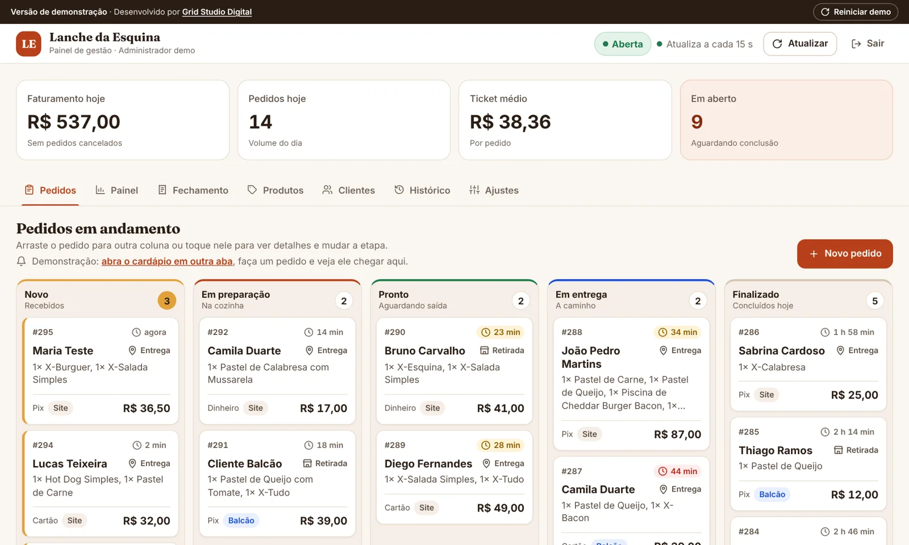
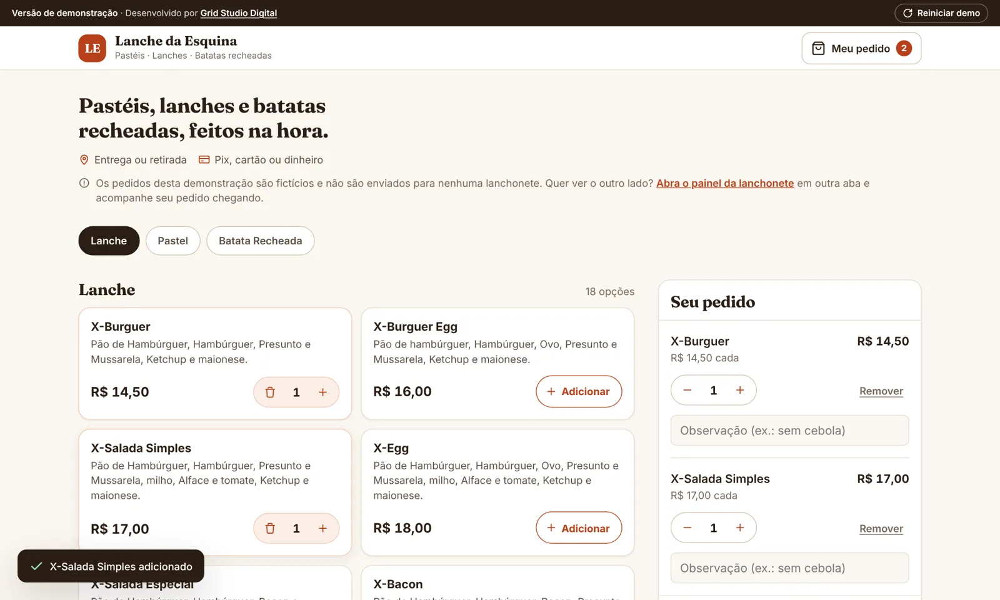
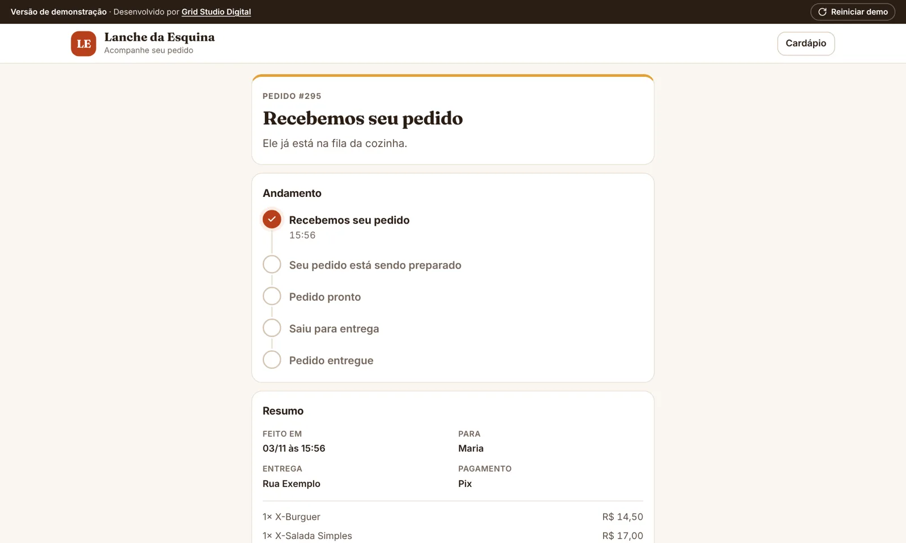
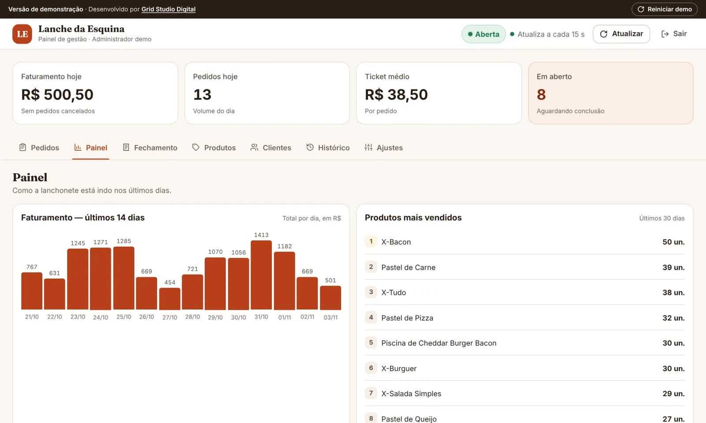
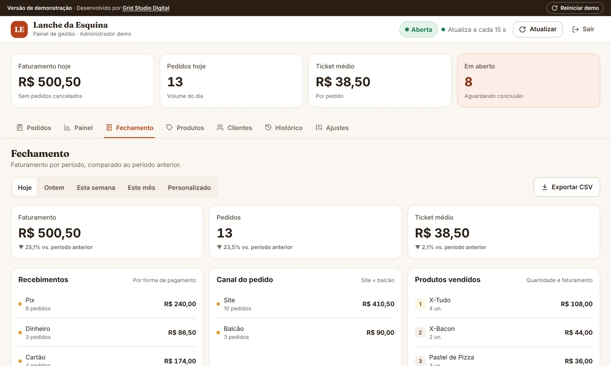
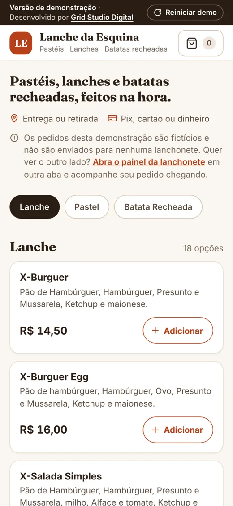

<h1 align="center">Sistema de Pedidos para Lanchonete</h1>

<p align="center">
  Cardápio online para o cliente + painel de gestão com Kanban de pedidos, dashboard e fechamento de caixa.<br>
  Desenvolvido para uma lanchonete de bairro real, que recebia pedidos pelo WhatsApp e controlava tudo à mão.
</p>

<p align="center">
  <a href="https://gustavo-pereiraa.github.io/demo-lanchonete/"></a>
  <a href="https://gustavo-pereiraa.github.io/demo-lanchonete/login"></a>
</p>

<p align="center">
  
  
  
  
  
  
  
  
</p>

<p align="center"></p>

---

## Sobre o projeto

Uma lanchonete familiar do interior de São Paulo atendia cerca de 20 pedidos por dia pelo WhatsApp, com anotações em papel e fechamento de caixa feito à mão. Desenvolvi um sistema web que organiza todo o fluxo: o cliente monta o pedido pelo cardápio online, a cozinha acompanha cada pedido em um quadro Kanban e a dona vê faturamento, produtos mais vendidos e fechamento por período.

O sistema real está em produção (Flask + PostgreSQL). **Este repositório traz também uma versão de demonstração que roda 100% no navegador**, com nome e dados fictícios, para qualquer pessoa testar sem cadastro.

## Como testar a demo

1. Abra o **[cardápio](https://gustavo-pereiraa.github.io/demo-lanchonete/)**, adicione itens e finalize um pedido (pode usar dados inventados).
2. Em outra aba, abra o **[painel](https://gustavo-pereiraa.github.io/demo-lanchonete/login)** e clique em **Entrar como demonstração**. Não precisa de e-mail nem senha.
3. Veja seu pedido chegar na coluna **Novo** do Kanban e arraste-o pelas etapas. A página de acompanhamento do cliente também acompanha a mudança.
4. Explore as abas **Painel**, **Fechamento**, **Produtos**, **Clientes** e **Histórico**.

Os pedidos ficam salvos só no seu navegador. O botão **Reiniciar demo**, no topo, volta tudo ao estado inicial.

## Telas

| Cardápio e carrinho | Acompanhamento do pedido |
|---|---|
|  |  |
| **Dashboard** | **Fechamento de caixa** |
|  |  |

<p align="center"><br><sub>Layout responsivo, pensado para o celular do cliente</sub></p>

## Como a demo funciona

O front-end é o mesmo do sistema real. Na demo, o arquivo `js/mock-api.js` intercepta as chamadas para `/api/...` e responde no próprio navegador, simulando o back-end com os mesmos formatos de resposta e guardando os dados no `localStorage`. Assim a demo pode ser hospedada de graça como site estático (GitHub Pages), sem servidor nem banco de dados.

| Pasta / arquivo | O que é |
|---|---|
| `index.html`, `admin.html`, `login.html`, `acompanhar.html`, `js/`, `css/` | Versão de demonstração (estática) |
| `app.py`, `templates/`, `static/`, `tests/` | Versão completa com back-end Flask |

## Funcionalidades

**Cliente**
- Cardápio por categoria, carrinho com observações por item
- Checkout com entrega ou retirada, 4 formas de pagamento (Pix, dinheiro
  com opção de troco, cartão, outro)
- Endereço obrigatório apenas quando o pedido é para entrega
- **Acompanhamento do pedido** em `/acompanhar/<token>` (link aleatório,
  nunca o número do pedido), com linha do tempo que se atualiza sozinha
  a cada 25 s. O cardápio mostra um atalho para pedidos em andamento
- **Loja fechada:** o cardápio continua visível, com aviso do próximo
  horário de abertura; adicionar e enviar ficam bloqueados
- **Esgotado hoje:** o produto aparece atenuado, com selo, e não pode ser
  pedido

**Painel administrativo**
- **Loja aberta/fechada:** indicador no cabeçalho; dois toques fecham a
  loja. Modos: seguir o horário, aberta ou fechada manualmente, com
  recado opcional. Pedidos de balcão continuam liberados com a loja
  fechada. Sem horário configurado, a loja fica sempre aberta
- **Ajustes:** horário de funcionamento por dia da semana (pode passar da
  meia-noite, ex.: 18:00 às 00:30) e **Minha conta** (troca de senha)
- **Esgotado hoje:** botão de um toque na lista de produtos e filtro
  "Esgotados hoje". Vale até as 5h do dia seguinte e volta sozinho
- **Pedidos:** Kanban (Novo → Em preparação → Pronto → Em entrega →
  Finalizado), arraste para mudar de coluna ou toque no card para ver
  detalhes e mudar o status pelos botões
- **Novo pedido (balcão/telefone):** botão "+ Novo pedido" na aba
  Pedidos — para quem atende no balcão ou por telefone registrar o
  pedido na hora, com o mesmo cardápio e cálculo de preço do site.
  Telefone do cliente é opcional aqui. Esses pedidos entram no Kanban,
  no histórico e nos relatórios normalmente, marcados como "Balcão"
  para diferenciar dos pedidos feitos pelo próprio cliente ("Site")
- **Painel:** faturamento dos últimos 14 dias, produtos mais vendidos,
  pedidos por horário, formas de pagamento do dia
- **Fechamento:** hoje / ontem / semana / mês / período personalizado,
  com comparação percentual em relação ao período anterior, e
  faturamento separado por canal (Site vs Balcão)
- **Produtos:** criar, editar, ativar/desativar (o histórico de pedidos
  antigos nunca é afetado) e gerenciar categorias
- **Clientes:** identificados automaticamente pelo telefone, com total
  gasto e histórico de pedidos
- **Histórico:** todos os pedidos (inclusive cancelados), com filtros por
  status, tipo, pagamento, produto, cliente, canal e período

## Segurança

Este projeto passou por uma revisão de segurança completa. O que já está
implementado:

- **Senhas com hash** (nunca em texto puro) usando `werkzeug.security`
- **Proteção contra XSS armazenado:** todo texto vindo de clientes (nome,
  telefone, endereço, observações) é escapado antes de aparecer no painel
- **Taxa de entrega definida só pelo servidor** (variável `DELIVERY_FEE`)
  — o cliente nunca pode alterar esse valor pela requisição
- **Limite de tentativas de login** (10/min por IP) contra força bruta
- **Limite de pedidos por IP** (12/min) contra spam/flood no cardápio público
- **Limite de tamanho de campos e de itens por pedido**, e limite de
  tamanho de requisição (512 KB), contra abuso e sobrecarga
- **Cabeçalhos de segurança HTTP** (CSP, X-Frame-Options, nosniff, HSTS
  em produção) e **cookie de sessão protegido** (Secure/HttpOnly/SameSite)
- **Aviso de uso de dados** exibido ao cliente no checkout
- **Log de tentativas de login** (sucesso e falha, com IP) para auditoria
- **Produção por padrão:** só é modo de desenvolvimento quando
  `FLASK_DEBUG=true` estiver definido explicitamente. Sem a variável, o
  sistema assume produção (cookie `Secure`, HSTS, avisos de senha padrão).
  No Render (variável `RENDER`, definida automaticamente) é sempre produção
- **IP real do cliente atrás do proxy do Render** (`ProxyFix` com um único
  salto confiável), para que os limites de requisição sejam por cliente
- **Conexões resistentes a ociosidade** (`pool_pre_ping` e `pool_recycle`)
  com o pooler do Supabase
- Aviso automático no console se `SECRET_KEY` ou `ADMIN_PASSWORD` ainda
  estiverem com o valor de exemplo em produção

## Modelo de dados

Tabelas: `customer`, `category`, `product`, `order`, `order_item` e
`order_status_history`. Cada item de pedido guarda uma "fotografia" do
nome e do preço do produto no momento da venda (`product_name_snapshot`,
`unit_price`), então renomear ou reprecificar um produto nunca altera
pedidos antigos — importante para relatórios e para uma futura análise
de dados.

Tabelas da v10 (criadas automaticamente na primeira requisição depois do
deploy, sem tocar nas tabelas acima): `store_settings` (modo da loja e
recado), `store_hours` (horário por dia da semana), `order_tracking`
(token público de acompanhamento por pedido) e `product_sold_out`
(produto esgotado por dia operacional). No PostgreSQL, uma trava
(`pg_advisory_xact_lock`) evita que dois workers criem as tabelas ao
mesmo tempo.

## Rodando a versão completa (Flask)

### Pré-requisito
Python 3.10 ou mais recente.

### Passo a passo

```bash
# 1. Entre na pasta do projeto
cd demo-lanchonete

# 2. Crie um ambiente virtual
python -m venv .venv

# 3. Ative o ambiente virtual
source .venv/bin/activate        # Linux/Mac
.venv\Scripts\activate           # Windows

# 4. Instale as dependências
pip install -r requirements.txt

# 5. Copie o arquivo de variáveis de ambiente
cp .env.example .env             # Windows: copy .env.example .env

# 6. Crie o banco com dados de demonstração (categorias, produtos,
#    clientes e pedidos de exemplo)
flask --app app.py seed

# 7. Rode o servidor
python app.py
```

Acesse:
- **Cliente:** http://localhost:5000
- **Painel administrativo:** http://localhost:5000/admin

Login do painel (criado pelo seed, definido no `.env`):
```
E-mail: dona@lanchonete.com
Senha:  lanchonete123
```

> Troque a senha em produção editando `ADMIN_PASSWORD` no `.env` **antes**
> de rodar o `seed` (o seed só cria o administrador na primeira vez).
> Para recomeçar do zero, apague o arquivo `instance/lanchonete.db` e
> rode o `seed` novamente.

## Testes

Os testes usam sempre um SQLite temporário (nunca o `DATABASE_URL` do
`.env`):

```bash
pip install -r requirements-dev.txt
python -m pytest tests
```

---

<p align="center">Desenvolvido por <a href="https://github.com/gustavo-pereiraa">Gustavo Rocha Pereira</a> · <a href="https://www.linkedin.com/in/gustavo-rocha-pereira-3068983bb">LinkedIn</a></p>
